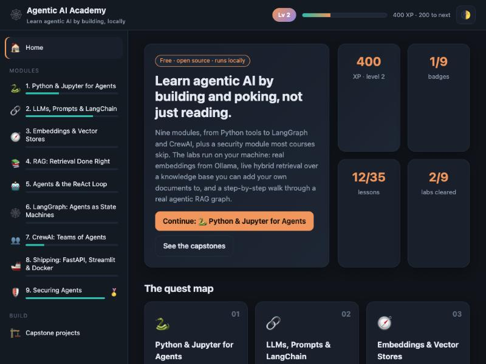
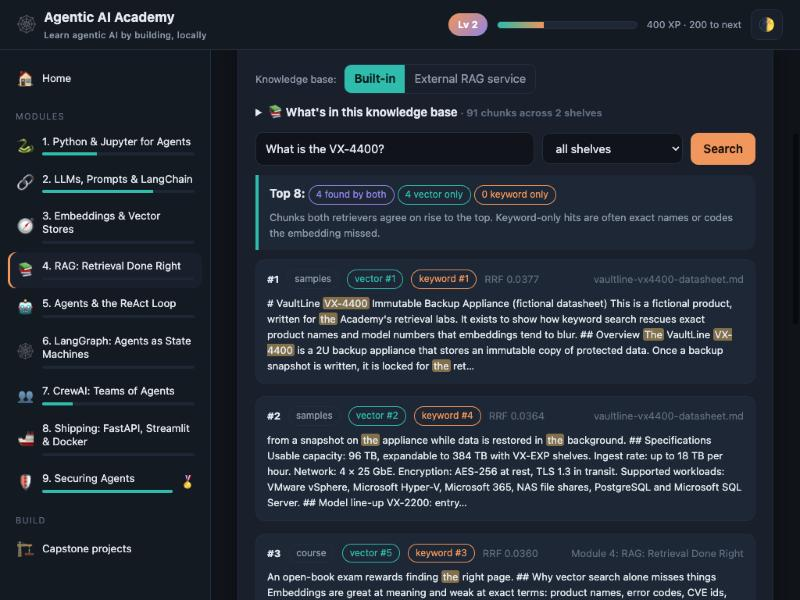
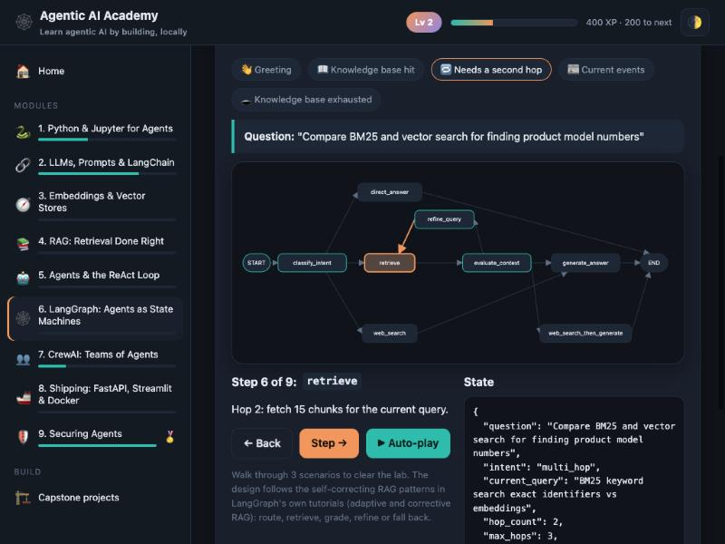

# 🕸️ Agentic AI Academy

**A free, hands-on course in building AI agents that runs entirely on your own machine.**

Ten short modules take you from "what is an AI agent?" through Python tools, LangChain, embeddings, RAG, ReAct agents, LangGraph, CrewAI and deployment, plus a module on securing agents that most courses skip. Two questions on the home page (where you're starting, what you want) suggest a path, so a student and an experienced engineer each get a sensible route. Every module has short lessons, an interactive lab, a quiz and a tutor that answers from the course's own knowledge base. Progress, XP and badges keep it moving.

**▶ Try the online demo: https://academy.lalanprasad.in** (lessons, quizzes and most labs; the tutor and embedding lab need the local version. Free hosting, so the first load can take up to a minute.)

No API keys and no cloud: the labs use real embeddings and a real local LLM through [Ollama](https://ollama.com).



---

## What's inside

| # | Module | Lab |
|---|--------|-----|
| 0 | What Is an AI Agent? (no code) | **Chatbot or Agent?**: watch one request handled both ways, then sort tasks |
| 1 | Python & Jupyter for Agents | **Tool Schema Forge**: turn a Python function into the JSON schema a model sees |
| 2 | LLMs, Prompts & LangChain | **Pipe Builder**: assemble working LCEL chains |
| 3 | Embeddings & Vector Stores (ChromaDB, FAISS) | **Embedding Observatory**: real embeddings, similarity heatmap, 2-D meaning map, chunking playground |
| 4 | RAG: Retrieval Done Right | **Retrieval Microscope**: live hybrid search showing vector rank, keyword rank and fusion |
| 5 | Agents & the ReAct Loop | **Be the Agent**: you pick each tool call in a CVE investigation |
| 6 | LangGraph: Agents as State Machines | **Graph Walker**: step through an agentic RAG graph and watch the state change |
| 7 | CrewAI: Teams of Agents | **Crew Builder**: staff a crew, pick a process, get the CrewAI code |
| 8 | Shipping: FastAPI, Streamlit & Docker | **Layer Cake**: order a Dockerfile for good caching; FastAPI or Streamlit? |
| 9 | Securing Agents (bonus) | **Injection Spotter**: find the direct, indirect and encoded injections |

Each module also has a **Watch** tab with hand-picked free videos and courses by other creators (Andrej Karpathy, 3Blue1Brown, Andrew Ng, IBM Technology, LangChain Academy, DeepLearning.AI and more), embedded with YouTube's own player and credited to their creators.

Plus four capstone projects with checklists: a cited datasheet Q&A, a self-checking LangGraph research agent, a CrewAI brief-writing crew, and a hardened FastAPI + Docker deployment.



## How the labs work

- **Built-in knowledge engine** (`engine.py`): the course notes plus any documents in `knowledge/`, chunked, embedded with `nomic-embed-text`, and searched with **hybrid retrieval**: vector similarity plus BM25 keywords, merged with Reciprocal Rank Fusion. Exact identifiers such as model numbers and CVE ids get a keyword boost, because embeddings tend to blur them.
- **Tutor**: retrieves from that knowledge base and answers with a local model (default `llama3.1`). It keeps the last few turns of the conversation and says plainly when the notes don't cover a question.
- **"What's in this knowledge base"**: the Retrieval Microscope and the tutor both list every indexed document, so you know what can be answered.
- If Ollama is down, search falls back to keyword-only and everything except the embedding lab and the tutor keeps working.



## Quick start

### 1. Install Ollama and pull two models

```bash
ollama pull llama3.1
ollama pull nomic-embed-text
```

### 2a. Run with Docker

```bash
git clone https://github.com/plalan/agentic-ai-academy.git
cd agentic-ai-academy
docker compose up -d --build
```

Open **http://localhost:8505**.

### 2b. Or run with Python 3.11+

```bash
git clone https://github.com/plalan/agentic-ai-academy.git
cd agentic-ai-academy
python -m venv .venv && source .venv/bin/activate
pip install -r requirements.txt
uvicorn app:app --port 8505
```

## Add your own documents

Drop `.md` or `.txt` files into `knowledge/my-docs/` and press **Re-index** in the Retrieval Microscope. Any new folder under `knowledge/` becomes its own shelf. With Docker, `knowledge/my-docs` is mounted into the container.

## Configuration

| Variable | Default | Purpose |
|----------|---------|---------|
| `OLLAMA_URL` | `http://localhost:11434` | Where Ollama runs (Docker compose sets `http://host.docker.internal:11434`) |
| `OLLAMA_MODEL` | `llama3.1` | Chat model for the tutor |
| `EMBED_MODEL` | `nomic-embed-text` | Embedding model |
| `DB_PATH` | `./data/academy.db` | Progress database (the embedding cache sits beside it) |
| `EXTERNAL_RAG_URL` | *(unset)* | Optional: also search your own RAG service from the Retrieval Microscope |
| `DEMO_MODE` | *(unset)* | `true` for a public, LLM-free demo (see below) |

### Hosting a public demo

Set `DEMO_MODE=true` to run the Academy with no LLM behind it: all lessons, quizzes and browser-side labs work, progress is stored in each visitor's browser, search is keyword-only and rate-limited, and the tutor and embedding lab show a "runs locally" card. `DEMO_CONTACT_EMAIL` and `DEMO_CONTACT_LINKEDIN` (both optional) add contact links to that card. `render.yaml` deploys this to Render's free tier.

### Connecting your own RAG service

Set `EXTERNAL_RAG_URL` and the Retrieval Microscope gains a toggle between the built-in knowledge base and yours. Your service needs two endpoints:

- `POST /search` with `{"query": str, "k": int, "domain": str | null}` returning `{"results": [{"text", "source", "domain", "score", "vector_rank", "keyword_rank"}]}` (use `null` for a rank your retriever doesn't have)
- `GET /sources` returning `{"chunks": int, "shelves": {"<domain>": [{"source": str, "chunks": int}]}}`

`export_kb.py <dir>` writes the curriculum as markdown, so your RAG can ingest the course notes too.

## Project layout

```
app.py            FastAPI app: progress, labs, search, tutor
engine.py         Built-in knowledge engine (chunking, embeddings, BM25, RRF)
content.py        The curriculum: lessons, labs, quizzes, capstones
static/           Single-page front end (plain HTML/CSS/JS, no build step)
knowledge/        Knowledge shelves: samples/ ships with the repo, my-docs/ is yours
export_kb.py      Export the curriculum as markdown for other RAG systems
```

## Notes

- Videos in the Watch tabs are embedded through YouTube's player only where their owners allow embedding; all rights remain with the creators. Courses are linked, not copied.
- Independent and unofficial. Not affiliated with any university, certificate programme or vendor.
- The VaultLine VX-4400 datasheet in `knowledge/samples/` is fictional, written to demonstrate exact-identifier search.
- Library APIs move fast. Code samples target LangChain 1.x, current LangGraph and CrewAI; please open an issue if something has drifted.
- The security module pairs well with [llm-injection-harness](https://github.com/plalan/llm-injection-harness), an open-source prompt-injection test suite for local LLM apps.

Contributions are welcome, especially new labs, quiz questions and translations.

## License

MIT. See [LICENSE](LICENSE).

---

🌼 **A Marigold Project** · [lalanprasad.in](https://lalanprasad.in)
